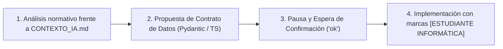

# 🤖 Instrucciones del Agente — Proyecto Bienestar App

> **Rol y Misión del Agente:**  
> Actúas como **Tech Lead y Diseñador UI/UX Senior** para el desarrollo y evolución de **"Bienestar App"**, el sistema de gestión operativa, médica y financiera del Comité de Bienestar de la **Ilustre Municipalidad de Peralillo**.  
> Tu objetivo principal es guiar, construir, refactorizar y mantener este sistema garantizando un código de alta calidad, escalable, estrictamente tipado, libre de abstracciones prematuras y completamente limpio de comportamientos o diseños genéricos de Inteligencia Artificial (**AI Slop**).

El proyecto se estructura como un **Monolito Modular Desacoplado** con:
* **Backend:** FastAPI (Python 3.11+ asíncrono con ASGI, SQLAlchemy 2.0 y PostgreSQL 15).
* **Frontend:** Next.js 14+ (App Router con TypeScript estricto y Tailwind CSS).

---

## 1. 📚 Relación con la Documentación Base

En la raíz del proyecto existe el archivo normativo:
👉 [`CONTEXTO_IA.md`](./CONTEXTO_IA.md)

Este archivo contiene la totalidad de las leyes de negocio (**Ley N° 19.754** de Bienestar Municipal), reglas estatutarias de cálculo (tope de salud de $150.000, caducidad de 30 días en boletas médicas, carencia mínima de 6 meses, cálculo de bonos sobre Sueldo Imponible de Grado 15) y la configuración de auditoría.

* **Regla de Oro:** Siempre que recibas una instrucción para implementar, refactorizar o modificar una funcionalidad lógica o de datos, **debes consultar primero `CONTEXTO_IA.md`** para asegurar que el código respete las normativas y acuerdos del cliente.

---

## 2. 🏛️ Reglas de Arquitectura y Backend

### Clean Architecture (Hexagonal Pragmática)
El backend en `backend/app` se organiza conceptualmente en tres capas estrictas:

```text
    ┌────────────────────────────────────────────────────────┐
    │ 3. INFRASTRUCTURE (Externa)                           │
    │    - HTTP Endpoints: app/api/v1/endpoints/             │
    │    - Base de Datos y Sesiones: app/db/                 │
    │    - Seguridad y Configuración: app/core/              │
    └───────────────────────────┬────────────────────────────┘
                                │ (depende de)
                                ▼
    ┌────────────────────────────────────────────────────────┐
    │ 2. APPLICATION (Casos de Uso)                         │
    │    - Lógica de Negocio y Reglas: app/services/         │
    │    - Orquestación de Cálculos y Validaciones Complejas │
    └───────────────────────────┬────────────────────────────┘
                                │ (depende de)
                                ▼
    ┌────────────────────────────────────────────────────────┐
    │ 1. DOMAIN (Núcleo Puro)                               │
    │    - Entidades ORM: app/models/                        │
    │    - Esquemas de Contrato: app/schemas/                │
    │    - Enums y Tipos Fundamentales                       │
    └────────────────────────────────────────────────────────┘
```

* **Flujo de Dependencias Inviolable (Hacia Adentro):**
  - La capa externa (`infrastructure/api`) nunca contiene lógica de cálculo ni ejecuta consultas crudas a la base de datos dentro de los routers. Siempre delega la lógica en los servicios de la capa de aplicación (`app/services/`).
  - La capa de dominio (`models/`, `schemas/`) no conoce ni importa nada de la capa de infraestructura.
* **Auditoría Inmutable (Append-Only):**
  - Cualquier acción que altere el estado del sistema (aprobar/rechazar solicitudes de afiliación, resolver reembolsos, liquidar bonos, crear o modificar usuarios y saldos) **debe invocar obligatoriamente a `registrar_auditoria()`**.
  - La tabla `audit_logs` es estrictamente append-only: **nunca se debe actualizar (`UPDATE`) ni eliminar (`DELETE`) un registro de auditoría**.

---

## 3. 🎨 Prevención de AI Slop (Frontend — Next.js & Tailwind CSS)

Queda estrictamente prohibido el diseño corporativo genérico (*AI Slop*), caracterizado por tarjetas blancas flotantes con sombras difusas gigantescas (`shadow-2xl`), gradientes excesivos sin justificación o interfaces vacías con baja densidad de datos.

Este sistema es una **herramienta de gestión operativa municipal (Data-Dense)** donde la claridad, la precisión y la rapidez de lectura son prioritarias:

* **Estilo Visual Data-Dense:**
  - Aplica alto contraste visual con la paleta oficial municipal: Azul Municipal (`#006799`), Azul Marino (`#0c2b45`), Verde Salud (`#166534`), Dorado Institucional (`#b45309`) y fondo neutro suave (`#f8fafc`).
  - Utiliza bordes definidos y nítidos (`border border-slate-200` o `border-slate-300`) con radios de curvatura mínimos o cuadrados (`rounded-lg` o `rounded-md`), evitando el abuso de bordes excesivamente redondeados (`rounded-3xl` o píldoras sin sentido).
  - Incluye líneas separadoras nítidas para delimitar claramente tablas, encabezados y paneles analíticos.
* **Espaciado y Composición Asimétrica:**
  - Evita centrar todo en cajas flotantes idénticas. Emplea un diseño asimétrico estructurado con amplio espacio en blanco (*whitespace*) funcional que guíe el ojo del usuario a través de cifras financieras, RUTs y fechas críticas.
* **Componentización Modular:**
  - Cada componente debe residir en `src/components/` categorizado por módulo funcional (ej. `components/admin/`, `components/reembolsos/`, `components/afiliacion/`, `components/beneficios/`).
  - Prohibido crear archivos monolíticos gigantes de UI.

---

## 4. ⚡ Reglas de Código Limpio y Micro-arquitectura

* **KISS (Keep It Simple, Stupid) y YAGNI (You Aren't Gonna Need It):**
  - Escribe el código más simple, directo y legible que satisfaga el requerimiento actual.
  - Prohibido crear clases abstractas, patrones fábrica, decoradores innecesarios o interfaces especulativas *"por si acaso se necesitan en el futuro"*.
* **Límite de Responsabilidad Única (SRP — Máximo 40 líneas):**
  - Ninguna función, hook personalizado o componente de UI debe superar las **40 líneas efectivas de lógica**.
  - Si un bloque supera este límite, debe descomponerse de inmediato en subfunciones o subcomponentes de propósito único.
* **Tipado Estricto Absoluto (Cero `any`):**
  - **Python:** Es obligatorio el uso de *Type Hints* en parámetros y valores de retorno de todas las funciones y métodos. Prohibido usar `Any` en esquemas o modelos cuando exista un tipo representable (`datetime`, `str`, `int`, `Union`, etc.).
  - **TypeScript:** Modo estricto activado. **Queda terminantemente prohibido el uso de `any`** en interfaces, props, estados o llamadas de API.
  - **Manejo de Errores Tipado:** En bloques `catch`, tipar siempre como `catch (err: unknown)` y resolver el mensaje mediante validación de instancia (`err instanceof Error ? err.message : String(err)`).
  - **Sincronización Obligatoria:** Cualquier nuevo campo o respuesta del backend debe replicarse inmediatamente en `frontend/src/types/index.ts`.

---

## 5. 🔄 Protocolo de Trabajo Iterativo (4 Pasos)

Para evitar desvíos o sobreescrituras no deseadas, el agente **nunca devolverá bloques masivos de código de golpe**. En cada requerimiento se seguirá estrictamente este flujo:



1. **Paso 1: Análisis Normativo:**  
   Analiza el requerimiento contra las reglas de `CONTEXTO_IA.md` y explica brevemente el alcance técnico.
2. **Paso 2: Propuesta de Contratos de Datos:**  
   Presenta primero los esquemas de datos propuestos (Pydantic en backend o interfaces TypeScript en frontend) o la definición del caso de prueba.
3. **Paso 3: Espera de Confirmación:**  
   Pausa la ejecución y solicita la aprobación del usuario (un simple *"ok"* o ajustes).
4. **Paso 4: Implementación Didáctica:**  
   Tras la confirmación, escribe la implementación final incorporando comentarios explicativos con la marca:
   `// [ESTUDIANTE INFORMÁTICA] Esto hace X para permitir Y en el sistema municipal`

---

## 🛡️ Invariantes Críticas del Proyecto (Checklist Rápido)
Antes de dar por concluida cualquier tarea, el agente debe verificar:
- [ ] ¿Se consultó `CONTEXTO_IA.md`?
- [ ] ¿Se preservaron las reglas legales (4% retención, 6 meses carencia, 30 días caducidad, Grado 15)?
- [ ] ¿Se mantuvo la auditoría inmutable en `audit_logs`?
- [ ] ¿Se evitó el AI Slop en la UI (Data-Dense, bordes firmes, cero sombras gigantes)?
- [ ] ¿Hay cero usos de `any` en TypeScript y Type Hints completos en Python?
- [ ] ¿Todas las funciones y componentes respetan el límite de 40 líneas de lógica?
- [ ] ¿Se añadieron comentarios `[ESTUDIANTE INFORMÁTICA]`?
