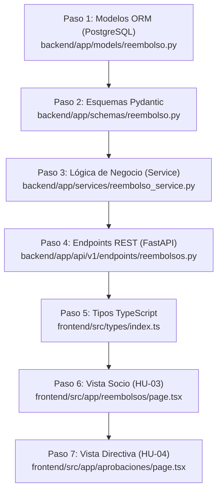
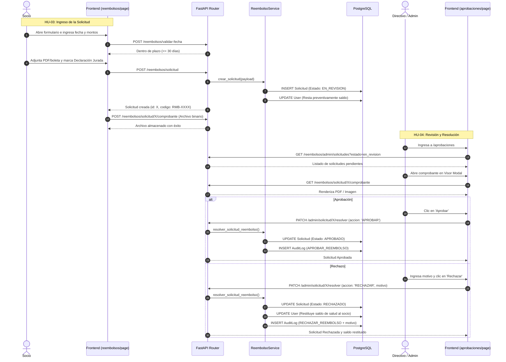

# Documento de Lectura 2: Guía Integral del Módulo 2 (HU-03 y HU-04)
## Reembolsos Médicos y Dentales • Solicitud, Auditoría y Resolución

Esta guía técnica y funcional documenta todo lo implementado en el **Módulo 2** del Sistema de Bienestar Municipal hasta la fecha, cubriendo la historia de usuario **HU-03** (Solicitud de Reembolso por el Socio) y el avance de la **HU-04** (Bandeja de Aprobaciones, Auditoría y Resolución por la Directiva/Administración).

Además, detalla el **paso a paso ordenado de la construcción** y especifica la **ubicación exacta de los comentarios explicativos** agregados en el código fuente con el enfoque didáctico de un estudiante de ingeniería en informática (*"Esto hace esto, y permite esto"*).

---

## 1. Resumen de Alcance del Módulo 2

El Módulo 2 digitaliza el ciclo completo de los gastos médicos y dentales que los socios presentan para reembolso ante el Comité de Bienestar:

### HU-03: Solicitud de Reembolso por el Socio
* **Regla de Carencia (Permanencia):** Exige un mínimo de **6 meses de antigüedad** como socio activo. Si no cumple, el sistema bloquea el ingreso y proyecta la fecha estimada de habilitación.
* **Plazo de Caducidad (30 días corridos):** La prestación médica y la fecha de la boleta no pueden superar los 30 días corridos al momento del ingreso. El sistema lo valida en tiempo real.
* **Topes y Saldo Anual:** Respeta el tope anual de salud ($150.000 / $250.000 según socio). El monto de copago solicitado no puede superar el saldo disponible ni el monto total de la boleta.
* **Retención Preventiva:** Al enviar la solicitud, el monto solicitado se reserva preventivamente de su saldo disponible para evitar sobregiros.
* **Respaldo Documental Obligatorio:** Requiere adjuntar boleta o comprobante digital (PDF o imagen JPG/PNG/WebP).
* **Declaración Jurada de Veracidad:** Checkbox legal obligatorio donde el socio certifica que los antecedentes son auténticos.

### HU-04: Bandeja de Revisión, Auditoría y Resolución (Directiva / Admin)
* **Bandeja Centralizada:** Vista en `/aprobaciones` exclusiva para roles superiores (`admin`, `superusuario`, miembros de directiva).
* **Visor de Comprobantes Embebido:** Modal que renderiza documentos PDF en un `<iframe>` o imágenes en pantalla con token de seguridad para que el evaluador no tenga que descargarlos manualmente.
* **Acción APROBAR:** Pasa el estado a `APROBADO`, confirma el descuento del saldo y genera cheque/transferencia.
* **Acción RECHAZAR:** Exige un motivo justificado obligatorio, cambia el estado a `RECHAZADO` y **restituye automáticamente el saldo preventivo** al socio.
* **Registro de Auditoría Inmutable:** Cada resolución genera una traza en la tabla `audit_logs` con usuario, RUT, rol, fecha/hora, acción y motivo.

---

## 2. Paso a Paso Ordenado de lo que se Realizó

### Paso 1: Base de Datos y Persistencia ORM
* Se creó la entidad [SolicitudReembolso](file:///c:/Users/Consultora%20Aligare/Downloads/bienestar-app/backend/app/models/reembolso.py#L65) en SQLAlchemy.
* Se estructuraron los enums [TipoPrestacion](file:///c:/Users/Consultora%20Aligare/Downloads/bienestar-app/backend/app/models/reembolso.py#L12) (Farmacia, Consulta, Exámenes, Dental, etc.) y [EstadoReembolso](file:///c:/Users/Consultora%20Aligare/Downloads/bienestar-app/backend/app/models/reembolso.py#L50) (`borrador`, `en_revision`, `aprobado`, `rechazado`, `pagado`).
* Se definieron los campos financieros (`monto_boleta`, `monto_copago`, `monto_reembolso`), fechas (`fecha_atencion`, `fecha_boleta`), respaldo físico (`comprobante_filename`, `comprobante_url`), el código correlativo de negocio (`codigo`) y el campo legal `declaracion_aceptada`.

### Paso 2: Esquemas de Validación y Tipado (Pydantic)
* En [backend/app/schemas/reembolso.py](file:///c:/Users/Consultora%20Aligare/Downloads/bienestar-app/backend/app/schemas/reembolso.py) se definieron:
  * `ReembolsoCreateRequest`: Con `@field_validator` para prohibir fechas futuras, validar que la prestación sea solicitable y obligar la aceptación de la declaración jurada.
  * `ResolverReembolsoRequest`: Para recibir y validar la acción de la directiva (`APROBAR` o `RECHAZAR`) y el motivo del rechazo.
  * `ResumenSaludSocio`, `ReembolsoOut` y `ValidacionFechaResponse`: Para entregar datos limpios y tipados al frontend.

### Paso 3: Servicio de Lógica de Negocio
* En [backend/app/services/reembolso_service.py](file:///c:/Users/Consultora%20Aligare/Downloads/bienestar-app/backend/app/services/reembolso_service.py) se implementaron las reglas oficiales:
  * `validar_carencia`: Compara la antigüedad contra los 6 meses mínimos (`MESES_CARENCIA = 6`).
  * `validar_plazo_30_dias`: Calcula los días transcurridos y evalúa si caducó (`DIAS_PLAZO_MAX = 30`).
  * `generar_codigo`: Genera la secuencia secuencial auditable (ej: `RMB-0001`).
  * `obtener_resumen_socio`: Calcula montos en revisión vs. aprobados, resta del cupo anual y sincroniza el saldo disponible.
  * `crear_solicitud`: Crea la entidad y rebaja preventivamente el saldo en la cuenta del usuario.
  * `resolver_solicitud_reembolso` (HU-04): Modifica el estado. Si la solicitud es rechazada, restituye el saldo disponible al socio. Deja constancia en `AuditLog`.

### Paso 4: Endpoints de la API REST
* En [backend/app/api/v1/endpoints/reembolsos.py](file:///c:/Users/Consultora%20Aligare/Downloads/bienestar-app/backend/app/api/v1/endpoints/reembolsos.py) se habilitaron las rutas:
  * `GET /`: Devuelve resumen y solicitudes del socio autenticado.
  * `POST /validar-fecha`: Permite la validación interactiva de los 30 días mientras el usuario teclea.
  * `POST /solicitud`: Valida reglas y crea la solicitud en estado `en_revision`.
  * `POST /solicitud/{id}/comprobante`: Recibe el archivo multipart, valida extensiones (PDF/JPG/PNG/WebP) y lo guarda en `uploads/reembolsos/`.
  * `GET /solicitud/{id}/comprobante`: Sirve el archivo con control de acceso por roles.
  * `GET /admin/solicitudes`: Bandeja general para roles Directiva y Admin.
  * `PATCH /admin/solicitud/{id}/resolver`: Ejecuta la aprobación o rechazo con auditoría.

### Paso 5: Contratos TypeScript en el Frontend
* En [frontend/src/types/index.ts](file:///c:/Users/Consultora%20Aligare/Downloads/bienestar-app/frontend/src/types/index.ts#L167) se crearon las interfaces `SolicitudReembolso`, `ResumenSaludSocio`, `ValidacionFechaResponse`, `TipoPrestacion` y `EstadoReembolso` para garantizar consistencia cliente-servidor.

### Paso 6: Interfaz del Socio (HU-03)
* En [frontend/src/app/reembolsos/page.tsx](file:///c:/Users/Consultora%20Aligare/Downloads/bienestar-app/frontend/src/app/reembolsos/page.tsx):
  * Se conectaron las tarjetas de saldo ([ResumenSaludCards.tsx](file:///c:/Users/Consultora%20Aligare/Downloads/bienestar-app/frontend/src/components/reembolsos/ResumenSaludCards.tsx)) con alerta de carencia si no cumple 6 meses.
  * Se implementó la tabla interactiva de solicitudes ([TablaSolicitudes.tsx](file:///c:/Users/Consultora%20Aligare/Downloads/bienestar-app/frontend/src/components/reembolsos/TablaSolicitudes.tsx)).
  * Se diseñó el formulario de nueva solicitud con validación de 30 días, carga de boleta y confirmación de declaración jurada en dos llamadas continuas (`POST /solicitud` y `POST /comprobante`).
  * Se integró el modal de detalles y el visor de documentos embebido.

### Paso 7: Bandeja de Aprobaciones de la Directiva (HU-04)
* En [frontend/src/app/aprobaciones/page.tsx](file:///c:/Users/Consultora%20Aligare/Downloads/bienestar-app/frontend/src/app/aprobaciones/page.tsx):
  * Vista protegida solo para Directiva y Administradores.
  * Filtro rápido por estados (`Pendiente`, `Aprobado`, `Rechazado`, `Todos`) y búsqueda por nombre o RUT.
  * Botones de acción directa con modales de confirmación para **Aprobar** y **Rechazar**.
  * En caso de rechazo, exige ingresar obligatoriamente el motivo para justificar la negativa ante el socio.

---

## 3. Registro y Ubicación de Comentarios en los Archivos Originales

Todos los comentarios fueron insertados en el código con la marca **`[ESTUDIANTE INFORMÁTICA]`** explicando de manera sencilla y clara qué hace cada bloque y qué permite en el sistema.

### 3.1. Archivo: `backend/app/models/reembolso.py`
Enlace directo: [backend/app/models/reembolso.py](file:///c:/Users/Consultora%20Aligare/Downloads/bienestar-app/backend/app/models/reembolso.py)

| Elemento / Bloque | Línea aprox. | Comentario / Explicación del Estudiante |
| :--- | :--- | :--- |
| `class TipoPrestacion` | L12 | *Esto define las categorías médicas permitidas y permite tipar de forma estricta los valores en la base de datos para no admitir textos arbitrarios.* |
| `TIPO_PRESTACION_LABELS` | L24 | *Esto es un diccionario de traducción; mapea cada clave del enum a un texto legible para el usuario y permite mostrar nombres amigables en la interfaz.* |
| `TIPOS_PRESTACION_SOLICITABLES` | L34 | *Esto define una lista blanca de tipos habilitados para HU-03 y permite que el formulario web solo acepte estas categorías al ingresar una nueva solicitud.* |
| `TIPOS_DOCUMENTO` | L43 | *Esto lista los tipos de comprobantes válidos y permite validar que el socio adjunte un documento de respaldo admitido por el reglamento.* |
| `class EstadoReembolso` | L53 | *Esto modela la máquina de estados del reembolso (HU-03 y HU-04) y permite controlar el ciclo de vida de la solicitud (desde que se crea hasta que se aprueba o rechaza).* |
| `ESTADO_REEMBOLSO_LABELS` | L63 | *Esto mapea los estados técnicos a nombres amigables en español y permite que el frontend renderice las etiquetas correctas en las tablas y modales.* |
| `class SolicitudReembolso` | L73 | *Esta clase define la tabla ORM en PostgreSQL (`solicitudes_reembolso`); esto mapea los atributos del objeto a columnas en la base de datos y permite guardar, consultar y actualizar todo el ciclo de vida de cada reembolso.* |
| `id` y `codigo` | L78 | *Esto es la clave primaria autoincremental y el código correlativo de negocio (ej: RMB-0001) que permite identificar de forma única la solicitud.* |
| `socio_id` | L82 | *Esto es la clave foránea hacia la tabla usuarios y permite asociar cada solicitud al socio que la presentó.* |
| `monto_boleta`, `monto_copago` | L98 | *Estos campos guardan los valores financieros del gasto y permiten calcular la cobertura y descontar del saldo disponible del socio.* |
| `fecha_atencion`, `fecha_boleta` | L104 | *Estas fechas registran cuándo ocurrió la atención médica y cuándo se emitió la boleta; esto permite validar la regla de los 30 días corridos de caducidad.* |
| `comprobante_filename`, `url` | L109 | *Estos campos almacenan los datos del archivo adjunto y permiten al sistema guardar la referencia física del comprobante en disco para que el admin lo visualice.* |
| `declaracion_aceptada` | L114 | *Esto almacena si el socio aceptó la declaración jurada de veracidad; esto permite tener respaldo legal de que los documentos son verídicos.* |
| `estado` y `motivo_rechazo` | L120 | *Esto almacena el estado actual (HU-04) y el motivo en caso de que sea rechazada; esto permite al revisor fundamentar su decisión y transparentarla al socio.* |
| `socio = relationship(...)` | L132 | *Esto crea la relación bidireccional ORM con el modelo User y permite acceder a los datos completos del socio (nombre, rut, correo) directamente desde la solicitud.* |

---

### 3.2. Archivo: `backend/app/schemas/reembolso.py`
Enlace directo: [backend/app/schemas/reembolso.py](file:///c:/Users/Consultora%20Aligare/Downloads/bienestar-app/backend/app/schemas/reembolso.py)

| Elemento / Bloque | Línea aprox. | Comentario / Explicación del Estudiante |
| :--- | :--- | :--- |
| `class ReembolsoCreateRequest` | L9 | *Esto valida el payload que envía el socio al crear una solicitud (HU-03) y permite asegurar tipos correctos, campos obligatorios y montos mayores a cero.* |
| `@field_validator("fecha_atencion", "fecha_boleta")` | L24 | *Esto intercepta las fechas y valida que no sean del futuro; permite evitar inconsistencias cronológicas antes de tocar la base de datos.* |
| `@field_validator("tipo_prestacion")` | L31 | *Esto valida que el tipo de prestación pertenezca a la lista de tipos solicitables vigentes de la HU-03.* |
| `@field_validator("tipo_documento")` | L40 | *Esto valida que el documento adjunto sea uno de los respaldos legalmente aceptados por Bienestar.* |
| `@field_validator("declaracion_aceptada")` | L49 | *Esto valida que el checkbox de declaración jurada esté estrictamente en True; permite blindar legalmente la veracidad de la solicitud.* |
| `class ResolverReembolsoRequest` | L62 | *Esto valida la petición enviada por directivos/administradores al resolver una solicitud (HU-04); permite recibir la acción (APROBAR o RECHAZAR) y exigir un motivo en caso de rechazo.* |
| `class ReembolsoOut` | L70 | *Este DTO define el formato con el que el backend envía la solicitud al frontend; permite transformar los campos internos de la base de datos a un formato JSON limpio y estructurado con etiquetas amigables.* |
| `class ResumenSaludSocio` | L101 | *Esto agrupa el estado de cuenta médico del socio (saldo anual, disponible, consumido y carencia); permite al frontend pintar las tarjetas de resumen y bloquear la solicitud si no cumple 6 meses de permanencia.* |
| `class ValidacionFechaResponse` | L121 | *Esto modela la respuesta del cálculo dinámico de la regla de los 30 días corridos; permite mostrar un mensaje en tiempo real al socio mientras elige la fecha.* |
| `class ReembolsoHistorialResponse` | L131 | *Esto encapsula tanto el resumen financiero como la lista histórica de reembolsos; permite responder al frontend en una sola petición HTTP eficiente.* |

---

### 3.3. Archivo: `backend/app/services/reembolso_service.py`
Enlace directo: [backend/app/services/reembolso_service.py](file:///c:/Users/Consultora%20Aligare/Downloads/bienestar-app/backend/app/services/reembolso_service.py)

| Función | Línea aprox. | Comentario / Explicación del Estudiante |
| :--- | :--- | :--- |
| `_parse_antiguedad_a_meses` | L46 | *Esta función auxiliar convierte textos como '5 Años, 4 Meses' a una cantidad entera de meses; esto permite hacer comparaciones numéricas directas con la carencia mínima.* |
| `_calcular_fecha_habilitacion` | L72 | *Esto calcula la fecha futura en que el socio cumplirá los 6 meses de permanencia; esto permite informarle con exactitud cuándo podrá solicitar beneficios.* |
| `validar_carencia` | L82 | *Esta función implementa la regla de negocio de carencia (HU-03: mínimo 6 meses); esto valida si el socio está habilitado y permite bloquear el formulario en caso contrario.* |
| `validar_plazo_30_dias` | L102 | *Esta función calcula los días transcurridos desde la atención médica hasta hoy; esto permite validar la regla de los 30 días corridos de caducidad que exige el reglamento.* |
| `generar_codigo` | L131 | *Esto consulta la cantidad de solicitudes en la base de datos y genera el siguiente correlativo (ej: RMB-0005); esto permite mantener un orden numérico auditable.* |
| `solicitud_to_out` | L139 | *Esto mapea una entidad ORM al DTO de salida ReembolsoOut; esto permite preparar los datos con formato legible para enviárselos al frontend.* |
| `obtener_resumen_socio` | L176 | *Esta función calcula las finanzas de salud del socio; suma lo que está en revisión y lo ya aprobado para restar del tope anual de $150.000 y permite saber exactamente cuánto saldo disponible le queda para nuevos gastos.* |
| `crear_solicitud` | L248 | *Esta función persiste la solicitud (HU-03) y descuenta de inmediato el copago del saldo del socio; esto permite apartar el dinero preventivamente para que no ingrese otra solicitud duplicada sin fondos.* |
| `listar_solicitudes_socio` | L290 | *Esta función recupera las solicitudes del socio autenticado ordenadas cronológicamente; permite renderizar la tabla del historial personal.* |
| `listar_todas_solicitudes_admin` | L302 | *Esta función carga todas las solicitudes de todos los socios (HU-04); esto permite a la Directiva y Administradores gestionar y auditar la bandeja central.* |
| `contar_solicitudes_pendientes_admin` | L321 | *Esto cuenta las solicitudes en estado 'en_revision'; permite mostrar el globito de alerta roja con la cantidad de pendientes en el menú.* |
| `resolver_solicitud_reembolso` | L330 | *Esta función es el corazón de la HU-04: resuelve la solicitud (APROBAR o RECHAZAR). Si se rechaza, le devuelve el saldo al socio; además, registra el suceso en AuditLog para que quede constancia inmutable de quién tomó la decisión y por qué.* |

---

### 3.4. Archivo: `backend/app/api/v1/endpoints/reembolsos.py`
Enlace directo: [backend/app/api/v1/endpoints/reembolsos.py](file:///c:/Users/Consultora%20Aligare/Downloads/bienestar-app/backend/app/api/v1/endpoints/reembolsos.py)

| Endpoint | Línea aprox. | Comentario / Explicación del Estudiante |
| :--- | :--- | :--- |
| `GET /` (`get_reembolsos`) | L58 | *Este endpoint atiende la carga inicial de la pantalla de reembolsos del socio; consulta el resumen de fondos y el listado de solicitudes para devolver ambos en una sola respuesta.* |
| `GET /resumen-socio` | L76 | *Este endpoint retorna únicamente las métricas de saldo de salud del socio; permite actualizar las tarjetas de saldo sin tener que recargar toda la lista de solicitudes.* |
| `POST /validar-fecha` | L93 | *Este endpoint recibe una fecha y verifica si está dentro del plazo de 30 días corridos; permite al frontend validar en vivo mientras el usuario selecciona la fecha en el calendario.* |
| `POST /solicitud` | L106 | *Este endpoint es el núcleo de HU-03 (Crear Solicitud); ejecuta 4 validaciones estrictas (carencia 6 meses, plazo 30 días, copago <= boleta y copago <= saldo disponible) y permite guardar la solicitud en estado 'en_revision'.* |
| `POST /solicitud/{id}/comprobante` | L230 | *Este endpoint recibe el archivo multipart (PDF/JPG/PNG) del comprobante; valida extensiones permitidas, guarda físicamente el archivo en la carpeta 'uploads/reembolsos/' con un nombre único y permite actualizar la URL de descarga en la solicitud.* |
| `GET /solicitud/{id}/comprobante` | L286 | *Este endpoint sirve el archivo físico al navegador; verifica que quien lo pide sea el propio socio o un directivo/auditor autorizado y permite previsualizar el PDF o imagen inline dentro del visor modal.* |
| `GET /admin/solicitudes` | L342 | *Este endpoint abastece la bandeja de Directiva/Administración (HU-04); restringe el acceso solo a administradores y permite filtrar solicitudes por su estado (ej: 'en_revision').* |
| `GET /admin/conteo-pendientes` | L362 | *Este endpoint entrega un contador rápido de pendientes; permite que la barra lateral y los badges del menú muestren la alerta numérica sin demoras.* |
| `PATCH /admin/solicitud/{id}/resolver` | L380 | *Este endpoint ejecuta la resolución de HU-04 (Aprobar o Rechazar); valida que el usuario sea Administrador o Superusuario, llama al servicio para actualizar el estado, maneja la restitución de saldo y permite auditar la operación.* |

---

### 3.5. Archivo: `frontend/src/app/reembolsos/page.tsx`
Enlace directo: [frontend/src/app/reembolsos/page.tsx](file:///c:/Users/Consultora%20Aligare/Downloads/bienestar-app/frontend/src/app/reembolsos/page.tsx)

| Bloque / Sección | Línea aprox. | Comentario / Explicación del Estudiante |
| :--- | :--- | :--- |
| `export default function ReembolsosPage` | L40 | *Componente principal de la vista del socio para el Módulo 2 (HU-03); orquesta la presentación del saldo de salud, historial de reembolsos y el formulario de ingreso.* |
| Estados de React (`resumen`, `solicitudes`) | L45 | *Estados de React: guardan la información reactiva traída desde la API (resumen financiero y lista de solicitudes) y controlan la visibilidad de los modales.* |
| `previewComprobante` | L58 | *Estado para el visor modal de comprobantes; permite mostrar el documento adjunto (PDF o imagen) sin salir de la página.* |
| `formData` | L70 | *Estado del formulario controlado: almacena los valores tipeados por el socio para enviarlos luego al backend.* |
| `fechaValidacion` | L84 | *Estado de validación en tiempo real; almacena si las fechas ingresadas están dentro de los 30 días corridos para avisarle al usuario al instante.* |
| `cargarReembolsos` | L92 | *Función asíncrona que consume 'GET /reembolsos/'; obtiene el resumen actualizado y las solicitudes para alimentar los componentes hijos.* |
| `handleSubmit`: Copago <= Boleta | L262 | *Validación lógica: el copago a reembolsar no puede superar el total pagado en la boleta.* |
| `handleSubmit`: Copago <= Saldo | L270 | *Validación financiera: el copago no puede superar el saldo de salud disponible del socio.* |
| `handleSubmit`: Archivo obligatorio | L278 | *Validación documental: es obligatorio adjuntar el archivo físico de respaldo.* |
| `handleSubmit`: Declaración jurada | L284 | *Validación legal: el socio debe haber marcado la declaración jurada de veracidad.* |
| `handleSubmit`: Guardado en 2 pasos | L290 | *Proceso de guardado en dos pasos: 1° crea la entidad en la base de datos vía JSON; 2° sube el archivo binario asociado al ID generado.* |

---

### 3.6. Archivo: `frontend/src/app/aprobaciones/page.tsx`
Enlace directo: [frontend/src/app/aprobaciones/page.tsx](file:///c:/Users/Consultora%20Aligare/Downloads/bienestar-app/frontend/src/app/aprobaciones/page.tsx)

| Bloque / Sección | Línea aprox. | Comentario / Explicación del Estudiante |
| :--- | :--- | :--- |
| `export default function AprobacionesPage` | L13 | *Componente principal de la bandeja de administración (HU-04); permite al Directorio y Administradores revisar, auditar, aprobar o rechazar solicitudes de reembolso.* |
| `esAdminOSuper` | L41 | *Control de acceso basado en roles (RBAC); restringe la visibilidad de los controles solo a Administradores o Superusuarios.* |
| `cargarSolicitudes` | L45 | *Esta función consume 'GET /reembolsos/admin/solicitudes'; obtiene la nómina completa de solicitudes de todos los funcionarios para ser evaluadas.* |
| `handleVerComprobante` | L67 | *Esta función arma la URL segura con token y abre el modal visor; permite inspeccionar la boleta médica sin descargarla manualmente.* |
| `handleConfirmarAprobar` | L126 | *Esta función ejecuta la resolución de APROBACIÓN (HU-04); hace un PATCH al backend pasando accion='APROBAR' y actualiza la tabla tras confirmar.* |
| `handleConfirmarRechazar` | L163 | *Esta función ejecuta la resolución de RECHAZO (HU-04); exige un motivo obligatorio, hace un PATCH con accion='RECHAZAR' y notifica que el saldo fue liberado al socio.* |

---

### 3.7. Archivo: `frontend/src/types/index.ts`
Enlace directo: [frontend/src/types/index.ts](file:///c:/Users/Consultora%20Aligare/Downloads/bienestar-app/frontend/src/types/index.ts#L167)

| Elemento | Línea aprox. | Comentario / Explicación del Estudiante |
| :--- | :--- | :--- |
| `type TipoPrestacion` | L169 | *Unión de literales para tipos de prestación; permite tipar fuertemente en TypeScript y evitar errores en tiempo de compilación.* |
| `type EstadoReembolso` | L206 | *Estados posibles de una solicitud; permite validar que solo se manejen estados reconocidos por el flujo del sistema.* |
| `interface SolicitudReembolso` | L213 | *Interfaz TypeScript que refleja una Solicitud de Reembolso completa; permite el autocompletado y validación de tipos al manipular solicitudes en React.* |

---

## 4. Diagrama del Flujo de Interacción y Estados

