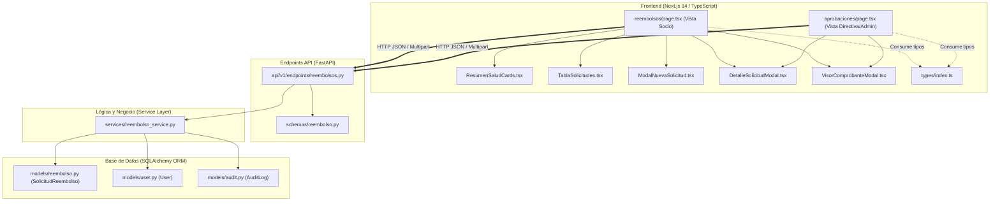

# Documento de Lectura 2: Módulo de Reembolsos Médicos y Dentales

Este documento es una guía de estudio técnica y funcional de la arquitectura del **Módulo de Reembolsos de Salud (HU-03)** en el sistema de Bienestar Municipal. Aquí se detallan todos los archivos involucrados, cómo se conectan entre sí y cuál es la responsabilidad de cada uno.

---

## 1. Mapa de Arquitectura General

El módulo sigue una arquitectura multicapa desacoplada:

---

## 2. Archivos del Backend

### 2.1. Modelos de Datos (ORM)
* **[backend/app/models/reembolso.py](file:///c:/Users/Consultora%20Aligare/Downloads/bienestar-app/backend/app/models/reembolso.py)**
  * **¿Qué hace?:** Define la estructura de persistencia en PostgreSQL para las solicitudes de reembolso.
  * **Elementos clave:**
    * `TipoPrestacion`: Enum con los tipos de gasto (`farmacia`, `consulta`, `examenes`, `programa_medico`, `otros`, `dental`, `optica`, `hospitalizacion`).
    * `TIPOS_PRESTACION_SOLICITABLES`: Lista blanca de prestaciones permitidas para ingreso.
    * `TIPOS_DOCUMENTO`: Tipos de comprobante válidos (`receta_medica`, `boleta_detallada`, `bono_copago`, etc.).
    * `EstadoReembolso`: Enum con los estados (`borrador`, `en_revision`, `aprobado`, `rechazado`, `pagado`).
    * `SolicitudReembolso`: Tabla `solicitudes_reembolso` con montos (`monto_boleta`, `monto_copago`, `monto_reembolso`), fechas (`fecha_atencion`, `fecha_boleta`), archivo adjunto (`comprobante_filename`, `comprobante_url`), declaración jurada de veracidad (`declaracion_aceptada`), código único correlativo (`codigo`) y relación con el socio (`socio_id`).

* **[backend/app/models/user.py](file:///c:/Users/Consultora%20Aligare/Downloads/bienestar-app/backend/app/models/user.py)**
  * **¿Qué hace?:** Modelo de usuario. Se conecta con reembolsos mediante:
    * `saldo_salud_disponible`: Saldo disponible en CLP para reembolsos.
    * `saldo_salud_total_anual`: Límite anual asignado al socio.
    * `antiguedad` y `meses_antiguedad`: Datos que validan la regla de permanencia mínima de 6 meses.

* **[backend/app/models/audit.py](file:///c:/Users/Consultora%20Aligare/Downloads/bienestar-app/backend/app/models/audit.py)**
  * **¿Qué hace?:** Registro inmutable de auditoría. Se invoca cuando una solicitud de reembolso es aprobada o rechazada.

---

### 2.2. Esquemas de Validación y Serialización (Pydantic)
* **[backend/app/schemas/reembolso.py](file:///c:/Users/Consultora%20Aligare/Downloads/bienestar-app/backend/app/schemas/reembolso.py)**
  * **¿Qué hace?:** Valida los datos que entran por la API y formatea los datos que salen hacia el frontend.
  * **Clases principales:**
    * `ReembolsoCreateRequest`: Valida que las fechas no sean futuras, que el tipo de prestación y documento sean permitidos, y que la declaración jurada esté aceptada (`declaracion_aceptada=True`).
    * `ResolverReembolsoRequest`: Valida la acción (`APROBAR` / `RECHAZAR`) y el motivo de rechazo.
    * `ReembolsoOut`: DTO para respuestas JSON con etiquetas legibles y datos formateados.
    * `ResumenSaludSocio`: DTO con métricas de salud (tope anual, disponible, consumido, carencia, etc.).
    * `ValidacionFechaResponse`: Respuesta al verificar el plazo de 30 días corridos.

---

### 2.3. Lógica de Negocio (Service Layer)
* **[backend/app/services/reembolso_service.py](file:///c:/Users/Consultora%20Aligare/Downloads/bienestar-app/backend/app/services/reembolso_service.py)**
  * **¿Qué hace?:** Centraliza las reglas de negocio del servicio de bienestar para salud.
  * **Funciones y Reglas:**
    1. `validar_carencia(user)`: Exige al menos 6 meses de antigüedad para poder solicitar reembolsos. Si no cumple, calcula la fecha proyectada de habilitación.
    2. `validar_plazo_30_dias(fecha)`: Exige que ni la fecha de atención ni la boleta tengan más de 30 días corridos de antigüedad respecto al día de ingreso.
    3. `generar_codigo(db)`: Genera códigos correlativos secuenciales (ej: `RMB-0001`).
    4. `obtener_resumen_socio(user, db)`: Calcula en tiempo real el saldo comprometido en solicitudes pendientes + aprobadas y actualiza el saldo disponible.
    5. `crear_solicitud(user, payload, ...)`: Descuenta preventivamente el saldo disponible del usuario y crea el registro en estado `EN_REVISION`.
    6. `resolver_solicitud_reembolso(...)`: Cambia el estado a `APROBADO` o `RECHAZADO`. En caso de rechazo, **restituye automáticamente el saldo disponible** al usuario y genera el registro en `AuditLog`.

---

### 2.4. Endpoints y Controladores API
* **[backend/app/api/v1/endpoints/reembolsos.py](file:///c:/Users/Consultora%20Aligare/Downloads/bienestar-app/backend/app/api/v1/endpoints/reembolsos.py)**
  * **¿Qué hace?:** Define las rutas REST HTTP y maneja la autenticación por token JWT y permisos.
  * **Rutas:**
    * `GET /api/v1/reembolsos/`: Historial de reembolsos del socio actual junto con su resumen de saldo.
    * `GET /api/v1/reembolsos/resumen-socio`: Solo métricas de saldo y carencia del socio.
    * `POST /api/v1/reembolsos/validar-fecha`: Validación en tiempo real de los 30 días desde el frontend.
    * `POST /api/v1/reembolsos/solicitud`: Creación de solicitud con validaciones de saldo, boleta >= copago y carencia.
    * `POST /api/v1/reembolsos/solicitud/{id}/comprobante`: Carga y almacenamiento del archivo físico de respaldo en disco local (`uploads/reembolsos/`).
    * `GET /api/v1/reembolsos/solicitud/{id}/comprobante`: Permite ver o descargar el comprobante adjunto según permisos de rol.
    * `GET /api/v1/reembolsos/admin/solicitudes`: Bandeja de todas las solicitudes para el rol Directiva/Admin.
    * `GET /api/v1/reembolsos/admin/conteo-pendientes`: Cantidad de solicitudes pendientes de revisión.
    * `PATCH /api/v1/reembolsos/admin/solicitud/{id}/resolver`: Ejecuta la aprobación o rechazo de una solicitud.

* **[backend/app/api/v1/api.py](file:///c:/Users/Consultora%20Aligare/Downloads/bienestar-app/backend/app/api/v1/api.py)**
  * **¿Qué hace?:** Registra el router de reembolsos en el enrutador maestro bajo el prefijo `/reembolsos`.

---

## 3. Archivos del Frontend

### 3.1. Tipos e Interfaces
* **[frontend/src/types/index.ts](file:///c:/Users/Consultora%20Aligare/Downloads/bienestar-app/frontend/src/types/index.ts)**
  * **¿Qué hace?:** Provee el contrato de tipos TypeScript para todo el módulo:
    * `SolicitudReembolso`
    * `ResumenSaludSocio`
    * `ValidacionFechaResponse`
    * `ReembolsoHistorialResponse`
    * `TipoPrestacion` y `EstadoReembolso`

---

### 3.2. Páginas (Rutas Next.js)
* **[frontend/src/app/reembolsos/page.tsx](file:///c:/Users/Consultora%20Aligare/Downloads/bienestar-app/frontend/src/app/reembolsos/page.tsx)**
  * **¿Qué hace?:** Vista principal del socio.
  * **Responsabilidades:**
    * Carga el resumen de saldos y la lista de solicitudes personales mediante `cargarReembolsos()`.
    * Controla el estado del formulario de nueva solicitud y el envío de dos pasos: primero `POST /solicitud` y luego `POST /comprobante` con el archivo seleccionado.
    * Controla la apertura de los modales de creación, detalle y visor de archivo.
* **[frontend/src/app/aprobaciones/page.tsx](file:///c:/Users/Consultora%20Aligare/Downloads/bienestar-app/frontend/src/app/aprobaciones/page.tsx)**
  * **¿Qué hace?:** Panel de revisión para administradores y directiva.
  * **Responsabilidades:**
    * Carga las solicitudes de todos los socios (`/reembolsos/admin/solicitudes`).
    * Permite filtrar por estado, buscar por socio o RUT y abrir el visor del comprobante.
    * Contiene los modales de confirmación para **Aprobar** o **Rechazar** (con ingreso obligatorio de motivo).

---

### 3.3. Componentes Específicos de Reembolsos
* **[frontend/src/components/reembolsos/ResumenSaludCards.tsx](file:///c:/Users/Consultora%20Aligare/Downloads/bienestar-app/frontend/src/components/reembolsos/ResumenSaludCards.tsx)**
  * **¿Qué hace?:** Renderiza las 4 tarjetas superiores de métricas:
    1. Saldo disponible.
    2. Saldo total anual y porcentaje de uso.
    3. Total reembolsado a la fecha.
    4. Solicitudes en revisión.
    * Si el socio no cumple los 6 meses de carencia, despliega una alerta preventiva destacada con la fecha exacta en la que se habilitará.
* **[frontend/src/components/reembolsos/TablaSolicitudes.tsx](file:///c:/Users/Consultora%20Aligare/Downloads/bienestar-app/frontend/src/components/reembolsos/TablaSolicitudes.tsx)**
  * **¿Qué hace?:** Lista el historial de solicitudes con badges de colores según estado (`Borrador`, `En Revisión`, `Aprobado`, `Rechazado`, `Pagado`). Permite filtrar por estado y contiene los botones para ver el detalle y el documento adjunto.
* **[frontend/src/components/reembolsos/ModalNuevaSolicitud.tsx](file:///c:/Users/Consultora%20Aligare/Downloads/bienestar-app/frontend/src/components/reembolsos/ModalNuevaSolicitud.tsx)**
  * **¿Qué hace?:** Modal con el formulario de ingreso del gasto médico:
    * Selección del tipo de prestación.
    * Identificación del beneficiario (Titular o Carga registrada).
    * Entrada de montos (Boleta y Copago).
    * Selector de fecha de atención con cálculo dinámico en pantalla si está fuera de los 30 días.
    * Carga de archivo PDF o imagen.
    * Checkbox obligatorio de declaración jurada de veracidad.
* **[frontend/src/components/reembolsos/DetalleSolicitudModal.tsx](file:///c:/Users/Consultora%20Aligare/Downloads/bienestar-app/frontend/src/components/reembolsos/DetalleSolicitudModal.tsx)**
  * **¿Qué hace?:** Modal de solo lectura que expone la ficha técnica completa de la solicitud (código correlativo, fecha de emisión, desglose de montos, motivo de rechazo si aplica y acceso directo al documento de respaldo).
* **[frontend/src/components/reembolsos/VisorComprobanteModal.tsx](file:///c:/Users/Consultora%20Aligare/Downloads/bienestar-app/frontend/src/components/reembolsos/VisorComprobanteModal.tsx)**
  * **¿Qué hace?:** Modal visor embebido que permite previsualizar documentos PDF en un iframe o imágenes en pantalla sin necesidad de descargarlos forzosamente, además de permitir descargar el archivo o reemplazarlo si es necesario.

---

## 4. Flujo de Datos Paso a Paso (Ciclo de Vida)

1. **Consulta inicial**:
   * El socio entra a `reembolsos/page.tsx`.
   * Frontend llama a `GET /api/v1/reembolsos/`.
   * Backend ejecuta `obtener_resumen_socio` y `listar_solicitudes_socio`, calculando saldos y restricciones de carencia.
2. **Ingreso de solicitud**:
   * El socio hace clic en "Nueva Solicitud" (`ModalNuevaSolicitud.tsx`).
   * Al elegir la fecha, el frontend valida los 30 días corridos llamando a `POST /validar-fecha`.
   * El socio envía el formulario: el frontend llama a `POST /solicitud` con los datos del gasto.
   * El servicio descuenta preventivamente el copago del `saldo_salud_disponible` del socio y guarda el registro en estado `EN_REVISION`.
   * El frontend toma el ID retornado y hace `POST /solicitud/{id}/comprobante` para guardar el archivo físico en el servidor.
3. **Revisión y Aprobación**:
   * El administrador entra a `aprobaciones/page.tsx`.
   * Revisa la solicitud y ve el archivo en `VisorComprobanteModal.tsx`.
   * Al hacer clic en "Aprobar" o "Rechazar", el frontend ejecuta `PATCH /admin/solicitud/{id}/resolver`.
   * Si se **aprueba**, el estado pasa a `APROBADO` y se audita en `AuditLog`.
   * Si se **rechaza**, el backend **restituye el saldo preventivo** al socio, guarda el motivo y lo registra en `AuditLog`.
