# 📊 Evidencia Técnica Oficial de Base de Datos PostgreSQL 15
**Proyecto:** Bienestar-App • Comité de Bienestar — I. Municipalidad de Peralillo
**Fuente:** Extracción directa de catálogo `information_schema` en contenedor `bienestar_postgres`
**Base de Datos:** `bienestar_db` | **Motor:** PostgreSQL 15-alpine

---
## 1. Resumen de Entidades Físicas en la Base de Datos

| N° | Nombre de Tabla Física | N° Columnas | Clave Primaria (PK) | Claves Foráneas (FK) | Registros Actuales |
| :--- | :--- | :--- | :--- | :--- | :--- |
| 1 | `audit_logs` | 12 | `id` | 0 | 9 |
| 2 | `bonos_catalogo` | 15 | `id` | 0 | 10 |
| 3 | `cargas_familiares` | 7 | `id` | 1 relaciones | 0 |
| 4 | `detalles_nomina_masiva` | 19 | `id` | 2 relaciones | 12 |
| 5 | `nominas_masivas` | 17 | `id` | 1 relaciones | 1 |
| 6 | `parametros_sistema` | 6 | `id` | 0 | 14 |
| 7 | `solicitudes_afiliacion` | 19 | `id` | 0 | 1 |
| 8 | `solicitudes_beneficio` | 32 | `id` | 3 relaciones | 14 |
| 9 | `solicitudes_cargas_familiares` | 21 | `id` | 1 relaciones | 0 |
| 10 | `solicitudes_reembolso` | 21 | `id` | 1 relaciones | 5 |
| 11 | `usuarios` | 17 | `id` | 0 | 13 |

---
## 2. Diagrama Entidad-Relación (MER Oficial en Mermaid)

```mermaid
erDiagram
    audit_logs {
        integer id PK
        timestamp_with_time_zone created_at 
        integer usuario_id 
        character_varying usuario_nombre 
        character_varying usuario_rut 
        character_varying usuario_rol 
        character_varying modulo 
        character_varying accion 
        character_varying recurso_tipo 
        character_varying recurso_id 
        text detalles 
        character_varying ip_origen 
    }
    bonos_catalogo {
        integer id PK
        character_varying codigo 
        character_varying nombre 
        double_precision porcentaje 
        character_varying categoria 
        text requisitos 
        text documentacion_requerida 
        text regla_asignacion 
        character_varying periodo_devengo 
        boolean permite_postulacion_socio 
        boolean es_calendario 
        boolean activo 
        character_varying icono 
        timestamp_with_time_zone created_at 
        timestamp_with_time_zone updated_at 
    }
    cargas_familiares {
        integer id PK
        integer solicitud_id FK
        character_varying nombre_completo 
        character_varying run 
        character_varying parentesco 
        timestamp_with_time_zone created_at 
        timestamp_with_time_zone updated_at 
    }
    detalles_nomina_masiva {
        integer id PK
        integer nomina_id FK
        integer socio_id FK
        character_varying rut 
        character_varying nombre_completo 
        character_varying departamento 
        character_varying antiguedad_texto 
        integer antiguedad_meses 
        boolean cumple_antiguedad 
        character_varying motivo_exclusion 
        integer monto 
        character_varying decreto_asociado 
        character_varying decreto_digital_url 
        character_varying metodo_pago 
        character_varying numero_cheque 
        character_varying banco 
        character_varying estado_pago 
        timestamp_with_time_zone created_at 
        timestamp_with_time_zone updated_at 
    }
    nominas_masivas {
        integer id PK
        character_varying tipo_bono 
        character_varying titulo 
        character_varying periodo 
        double_precision porcentaje 
        integer sueldo_base_utilizado 
        integer monto_unitario 
        integer total_socios_evaluados 
        integer total_socios_beneficiados 
        integer total_socios_excluidos 
        integer monto_total_liquidado 
        character_varying estado 
        character_varying decreto_marco 
        character_varying acuerdo_directorio_acta 
        integer creado_por_id FK
        timestamp_with_time_zone created_at 
        timestamp_with_time_zone updated_at 
    }
    parametros_sistema {
        integer id PK
        character_varying clave 
        character_varying valor 
        character_varying descripcion 
        timestamp_with_time_zone created_at 
        timestamp_with_time_zone updated_at 
    }
    solicitudes_afiliacion {
        integer id PK
        character_varying folio 
        character_varying nombre_completo 
        character_varying run 
        character_varying grado 
        USER-DEFINED calidad_contractual 
        character_varying email 
        boolean autoriza_descuento 
        integer porcentaje_descuento 
        boolean acepta_carencia 
        USER-DEFINED estado 
        character_varying fecha_sesion 
        character_varying numero_acta 
        character_varying fecha_fin_carencia 
        character_varying observaciones_resolucion 
        character_varying resuelto_por 
        character_varying resuelto_at 
        timestamp_with_time_zone created_at 
        timestamp_with_time_zone updated_at 
    }
    solicitudes_beneficio {
        integer id PK
        integer socio_id FK
        character_varying tipo_bono 
        character_varying titulo_bono 
        double_precision porcentaje_base 
        integer sueldo_base_referencia 
        integer monto_calculado 
        character_varying estado 
        text motivo 
        character_varying documento_tipo 
        character_varying documento_nombre 
        character_varying documento_url 
        character_varying decreto_numero 
        character_varying decreto_fecha 
        integer dias_habiles_feriado 
        character_varying nombre_beneficiario 
        character_varying rut_beneficiario 
        character_varying institucion_educacional 
        character_varying nivel_educacional 
        integer edad_estudiante 
        boolean asignacion_directa 
        text motivo_rechazo 
        text observaciones_admin 
        integer revisado_por_id FK
        timestamp_with_time_zone fecha_revision 
        character_varying metodo_pago 
        character_varying numero_cheque 
        character_varying banco_emisor 
        timestamp_with_time_zone fecha_liquidacion 
        integer liquidado_por_id FK
        timestamp_with_time_zone created_at 
        timestamp_with_time_zone updated_at 
    }
    solicitudes_cargas_familiares {
        integer id PK
        character_varying folio 
        integer socio_id FK
        character_varying socio_nombre 
        character_varying socio_rut 
        character_varying socio_email 
        character_varying nombre_completo 
        character_varying run 
        character_varying parentesco 
        character_varying observacion_socio 
        character_varying certificado_nombre 
        character_varying certificado_tipo 
        text certificado_data 
        USER-DEFINED estado 
        character_varying fecha_sesion 
        character_varying numero_acta 
        character_varying observaciones_resolucion 
        character_varying resuelto_por 
        character_varying resuelto_at 
        timestamp_with_time_zone created_at 
        timestamp_with_time_zone updated_at 
    }
    solicitudes_reembolso {
        integer id PK
        character_varying codigo 
        integer socio_id FK
        USER-DEFINED tipo_prestacion 
        text descripcion 
        character_varying beneficiario_nombre 
        character_varying beneficiario_parentesco 
        double_precision monto_boleta 
        double_precision monto_copago 
        double_precision monto_reembolso 
        date fecha_atencion 
        date fecha_boleta 
        character_varying tipo_documento 
        character_varying comprobante_filename 
        character_varying comprobante_url 
        boolean declaracion_aceptada 
        USER-DEFINED estado 
        text motivo_rechazo 
        timestamp_with_time_zone created_at 
        timestamp_with_time_zone updated_at 
        character_varying beneficiario_run 
    }
    usuarios {
        integer id PK
        character_varying rut 
        character_varying email 
        character_varying nombre_completo 
        character_varying hashed_password 
        USER-DEFINED rol 
        boolean is_superuser 
        boolean is_active 
        character_varying departamento 
        character_varying antiguedad 
        character_varying estado_previsional 
        integer saldo_salud_disponible 
        integer saldo_salud_total_anual 
        integer cargas_registradas 
        integer meses_antiguedad 
        timestamp_with_time_zone created_at 
        timestamp_with_time_zone updated_at 
    }
    solicitudes_afiliacion ||--o{ cargas_familiares : "solicitud_id -> id"
    nominas_masivas ||--o{ detalles_nomina_masiva : "nomina_id -> id"
    usuarios ||--o{ detalles_nomina_masiva : "socio_id -> id"
    usuarios ||--o{ nominas_masivas : "creado_por_id -> id"
    usuarios ||--o{ solicitudes_beneficio : "socio_id -> id"
    usuarios ||--o{ solicitudes_beneficio : "revisado_por_id -> id"
    usuarios ||--o{ solicitudes_beneficio : "liquidado_por_id -> id"
    usuarios ||--o{ solicitudes_cargas_familiares : "socio_id -> id"
    usuarios ||--o{ solicitudes_reembolso : "socio_id -> id"
```

---
## 3. Fichas Técnicas de Atributos por Entidad (Reemplazo Figuras 3 a 13)

### 3.1. Tabla: `audit_logs` (9 registros)
| Columna | Tipo de Dato PostgreSQL | ¿Permite Nulos? | Rol de Clave | Valor por Defecto |
| :--- | :--- | :--- | :--- | :--- |
| `id` | `integer` | **NO** | 🔑 **PRIMARY KEY** | `AUTO_INCREMENT (SERIAL)` |
| `created_at` | `timestamp with time zone` | **NO** |  | `now()` |
| `usuario_id` | `integer` | SÍ |  | - |
| `usuario_nombre` | `character varying` | **NO** |  | - |
| `usuario_rut` | `character varying` | SÍ |  | - |
| `usuario_rol` | `character varying` | **NO** |  | - |
| `modulo` | `character varying` | **NO** |  | - |
| `accion` | `character varying` | **NO** |  | - |
| `recurso_tipo` | `character varying` | **NO** |  | - |
| `recurso_id` | `character varying` | SÍ |  | - |
| `detalles` | `text` | SÍ |  | - |
| `ip_origen` | `character varying` | SÍ |  | - |

### 3.2. Tabla: `bonos_catalogo` (10 registros)
| Columna | Tipo de Dato PostgreSQL | ¿Permite Nulos? | Rol de Clave | Valor por Defecto |
| :--- | :--- | :--- | :--- | :--- |
| `id` | `integer` | **NO** | 🔑 **PRIMARY KEY** | `AUTO_INCREMENT (SERIAL)` |
| `codigo` | `character varying` | **NO** |  | - |
| `nombre` | `character varying` | **NO** |  | - |
| `porcentaje` | `double precision` | **NO** |  | - |
| `categoria` | `character varying` | **NO** |  | - |
| `requisitos` | `text` | **NO** |  | - |
| `documentacion_requerida` | `text` | **NO** |  | - |
| `regla_asignacion` | `text` | **NO** |  | - |
| `periodo_devengo` | `character varying` | SÍ |  | - |
| `permite_postulacion_socio` | `boolean` | **NO** |  | - |
| `es_calendario` | `boolean` | **NO** |  | - |
| `activo` | `boolean` | **NO** |  | - |
| `icono` | `character varying` | **NO** |  | - |
| `created_at` | `timestamp with time zone` | **NO** |  | `now()` |
| `updated_at` | `timestamp with time zone` | **NO** |  | `now()` |

### 3.3. Tabla: `cargas_familiares` (0 registros)
| Columna | Tipo de Dato PostgreSQL | ¿Permite Nulos? | Rol de Clave | Valor por Defecto |
| :--- | :--- | :--- | :--- | :--- |
| `id` | `integer` | **NO** | 🔑 **PRIMARY KEY** | `AUTO_INCREMENT (SERIAL)` |
| `solicitud_id` | `integer` | **NO** | 🔗 **FOREIGN KEY** (`solicitudes_afiliacion.id`) | - |
| `nombre_completo` | `character varying` | **NO** |  | - |
| `run` | `character varying` | **NO** |  | - |
| `parentesco` | `character varying` | SÍ |  | - |
| `created_at` | `timestamp with time zone` | **NO** |  | `now()` |
| `updated_at` | `timestamp with time zone` | **NO** |  | `now()` |

### 3.4. Tabla: `detalles_nomina_masiva` (12 registros)
| Columna | Tipo de Dato PostgreSQL | ¿Permite Nulos? | Rol de Clave | Valor por Defecto |
| :--- | :--- | :--- | :--- | :--- |
| `id` | `integer` | **NO** | 🔑 **PRIMARY KEY** | `AUTO_INCREMENT (SERIAL)` |
| `nomina_id` | `integer` | **NO** | 🔗 **FOREIGN KEY** (`nominas_masivas.id`) | - |
| `socio_id` | `integer` | SÍ | 🔗 **FOREIGN KEY** (`usuarios.id`) | - |
| `rut` | `character varying` | **NO** |  | - |
| `nombre_completo` | `character varying` | **NO** |  | - |
| `departamento` | `character varying` | **NO** |  | - |
| `antiguedad_texto` | `character varying` | **NO** |  | - |
| `antiguedad_meses` | `integer` | **NO** |  | - |
| `cumple_antiguedad` | `boolean` | **NO** |  | - |
| `motivo_exclusion` | `character varying` | SÍ |  | - |
| `monto` | `integer` | **NO** |  | - |
| `decreto_asociado` | `character varying` | SÍ |  | - |
| `decreto_digital_url` | `character varying` | SÍ |  | - |
| `metodo_pago` | `character varying` | **NO** |  | - |
| `numero_cheque` | `character varying` | SÍ |  | - |
| `banco` | `character varying` | SÍ |  | - |
| `estado_pago` | `character varying` | **NO** |  | - |
| `created_at` | `timestamp with time zone` | **NO** |  | `now()` |
| `updated_at` | `timestamp with time zone` | **NO** |  | `now()` |

### 3.5. Tabla: `nominas_masivas` (1 registros)
| Columna | Tipo de Dato PostgreSQL | ¿Permite Nulos? | Rol de Clave | Valor por Defecto |
| :--- | :--- | :--- | :--- | :--- |
| `id` | `integer` | **NO** | 🔑 **PRIMARY KEY** | `AUTO_INCREMENT (SERIAL)` |
| `tipo_bono` | `character varying` | **NO** |  | - |
| `titulo` | `character varying` | **NO** |  | - |
| `periodo` | `character varying` | **NO** |  | - |
| `porcentaje` | `double precision` | **NO** |  | - |
| `sueldo_base_utilizado` | `integer` | **NO** |  | - |
| `monto_unitario` | `integer` | **NO** |  | - |
| `total_socios_evaluados` | `integer` | **NO** |  | - |
| `total_socios_beneficiados` | `integer` | **NO** |  | - |
| `total_socios_excluidos` | `integer` | **NO** |  | - |
| `monto_total_liquidado` | `integer` | **NO** |  | - |
| `estado` | `character varying` | **NO** |  | - |
| `decreto_marco` | `character varying` | SÍ |  | - |
| `acuerdo_directorio_acta` | `character varying` | SÍ |  | - |
| `creado_por_id` | `integer` | **NO** | 🔗 **FOREIGN KEY** (`usuarios.id`) | - |
| `created_at` | `timestamp with time zone` | **NO** |  | `now()` |
| `updated_at` | `timestamp with time zone` | **NO** |  | `now()` |

### 3.6. Tabla: `parametros_sistema` (14 registros)
| Columna | Tipo de Dato PostgreSQL | ¿Permite Nulos? | Rol de Clave | Valor por Defecto |
| :--- | :--- | :--- | :--- | :--- |
| `id` | `integer` | **NO** | 🔑 **PRIMARY KEY** | `AUTO_INCREMENT (SERIAL)` |
| `clave` | `character varying` | **NO** |  | - |
| `valor` | `character varying` | **NO** |  | - |
| `descripcion` | `character varying` | **NO** |  | - |
| `created_at` | `timestamp with time zone` | **NO** |  | `now()` |
| `updated_at` | `timestamp with time zone` | **NO** |  | `now()` |

### 3.7. Tabla: `solicitudes_afiliacion` (1 registros)
| Columna | Tipo de Dato PostgreSQL | ¿Permite Nulos? | Rol de Clave | Valor por Defecto |
| :--- | :--- | :--- | :--- | :--- |
| `id` | `integer` | **NO** | 🔑 **PRIMARY KEY** | `AUTO_INCREMENT (SERIAL)` |
| `folio` | `character varying` | **NO** |  | - |
| `nombre_completo` | `character varying` | **NO** |  | - |
| `run` | `character varying` | **NO** |  | - |
| `grado` | `character varying` | **NO** |  | - |
| `calidad_contractual` | `USER-DEFINED` | **NO** |  | - |
| `email` | `character varying` | SÍ |  | - |
| `autoriza_descuento` | `boolean` | **NO** |  | - |
| `porcentaje_descuento` | `integer` | **NO** |  | - |
| `acepta_carencia` | `boolean` | **NO** |  | - |
| `estado` | `USER-DEFINED` | **NO** |  | - |
| `fecha_sesion` | `character varying` | SÍ |  | - |
| `numero_acta` | `character varying` | SÍ |  | - |
| `fecha_fin_carencia` | `character varying` | SÍ |  | - |
| `observaciones_resolucion` | `character varying` | SÍ |  | - |
| `resuelto_por` | `character varying` | SÍ |  | - |
| `resuelto_at` | `character varying` | SÍ |  | - |
| `created_at` | `timestamp with time zone` | **NO** |  | `now()` |
| `updated_at` | `timestamp with time zone` | **NO** |  | `now()` |

### 3.8. Tabla: `solicitudes_beneficio` (14 registros)
| Columna | Tipo de Dato PostgreSQL | ¿Permite Nulos? | Rol de Clave | Valor por Defecto |
| :--- | :--- | :--- | :--- | :--- |
| `id` | `integer` | **NO** | 🔑 **PRIMARY KEY** | `AUTO_INCREMENT (SERIAL)` |
| `socio_id` | `integer` | **NO** | 🔗 **FOREIGN KEY** (`usuarios.id`) | - |
| `tipo_bono` | `character varying` | **NO** |  | - |
| `titulo_bono` | `character varying` | **NO** |  | - |
| `porcentaje_base` | `double precision` | **NO** |  | - |
| `sueldo_base_referencia` | `integer` | **NO** |  | - |
| `monto_calculado` | `integer` | **NO** |  | - |
| `estado` | `character varying` | **NO** |  | - |
| `motivo` | `text` | SÍ |  | - |
| `documento_tipo` | `character varying` | **NO** |  | - |
| `documento_nombre` | `character varying` | SÍ |  | - |
| `documento_url` | `character varying` | SÍ |  | - |
| `decreto_numero` | `character varying` | SÍ |  | - |
| `decreto_fecha` | `character varying` | SÍ |  | - |
| `dias_habiles_feriado` | `integer` | SÍ |  | - |
| `nombre_beneficiario` | `character varying` | SÍ |  | - |
| `rut_beneficiario` | `character varying` | SÍ |  | - |
| `institucion_educacional` | `character varying` | SÍ |  | - |
| `nivel_educacional` | `character varying` | SÍ |  | - |
| `edad_estudiante` | `integer` | SÍ |  | - |
| `asignacion_directa` | `boolean` | **NO** |  | - |
| `motivo_rechazo` | `text` | SÍ |  | - |
| `observaciones_admin` | `text` | SÍ |  | - |
| `revisado_por_id` | `integer` | SÍ | 🔗 **FOREIGN KEY** (`usuarios.id`) | - |
| `fecha_revision` | `timestamp with time zone` | SÍ |  | - |
| `metodo_pago` | `character varying` | SÍ |  | - |
| `numero_cheque` | `character varying` | SÍ |  | - |
| `banco_emisor` | `character varying` | SÍ |  | - |
| `fecha_liquidacion` | `timestamp with time zone` | SÍ |  | - |
| `liquidado_por_id` | `integer` | SÍ | 🔗 **FOREIGN KEY** (`usuarios.id`) | - |
| `created_at` | `timestamp with time zone` | **NO** |  | `now()` |
| `updated_at` | `timestamp with time zone` | **NO** |  | `now()` |

### 3.9. Tabla: `solicitudes_cargas_familiares` (0 registros)
| Columna | Tipo de Dato PostgreSQL | ¿Permite Nulos? | Rol de Clave | Valor por Defecto |
| :--- | :--- | :--- | :--- | :--- |
| `id` | `integer` | **NO** | 🔑 **PRIMARY KEY** | `AUTO_INCREMENT (SERIAL)` |
| `folio` | `character varying` | **NO** |  | - |
| `socio_id` | `integer` | **NO** | 🔗 **FOREIGN KEY** (`usuarios.id`) | - |
| `socio_nombre` | `character varying` | **NO** |  | - |
| `socio_rut` | `character varying` | **NO** |  | - |
| `socio_email` | `character varying` | SÍ |  | - |
| `nombre_completo` | `character varying` | **NO** |  | - |
| `run` | `character varying` | **NO** |  | - |
| `parentesco` | `character varying` | **NO** |  | - |
| `observacion_socio` | `character varying` | SÍ |  | - |
| `certificado_nombre` | `character varying` | SÍ |  | - |
| `certificado_tipo` | `character varying` | SÍ |  | - |
| `certificado_data` | `text` | SÍ |  | - |
| `estado` | `USER-DEFINED` | **NO** |  | - |
| `fecha_sesion` | `character varying` | SÍ |  | - |
| `numero_acta` | `character varying` | SÍ |  | - |
| `observaciones_resolucion` | `character varying` | SÍ |  | - |
| `resuelto_por` | `character varying` | SÍ |  | - |
| `resuelto_at` | `character varying` | SÍ |  | - |
| `created_at` | `timestamp with time zone` | **NO** |  | `now()` |
| `updated_at` | `timestamp with time zone` | **NO** |  | `now()` |

### 3.10. Tabla: `solicitudes_reembolso` (5 registros)
| Columna | Tipo de Dato PostgreSQL | ¿Permite Nulos? | Rol de Clave | Valor por Defecto |
| :--- | :--- | :--- | :--- | :--- |
| `id` | `integer` | **NO** | 🔑 **PRIMARY KEY** | `AUTO_INCREMENT (SERIAL)` |
| `codigo` | `character varying` | **NO** |  | - |
| `socio_id` | `integer` | **NO** | 🔗 **FOREIGN KEY** (`usuarios.id`) | - |
| `tipo_prestacion` | `USER-DEFINED` | **NO** |  | - |
| `descripcion` | `text` | **NO** |  | - |
| `beneficiario_nombre` | `character varying` | **NO** |  | - |
| `beneficiario_parentesco` | `character varying` | **NO** |  | - |
| `monto_boleta` | `double precision` | **NO** |  | - |
| `monto_copago` | `double precision` | **NO** |  | - |
| `monto_reembolso` | `double precision` | **NO** |  | - |
| `fecha_atencion` | `date` | **NO** |  | - |
| `fecha_boleta` | `date` | **NO** |  | - |
| `tipo_documento` | `character varying` | **NO** |  | `''::character varying` |
| `comprobante_filename` | `character varying` | **NO** |  | - |
| `comprobante_url` | `character varying` | **NO** |  | - |
| `declaracion_aceptada` | `boolean` | **NO** |  | `false` |
| `estado` | `USER-DEFINED` | **NO** |  | - |
| `motivo_rechazo` | `text` | **NO** |  | - |
| `created_at` | `timestamp with time zone` | **NO** |  | `now()` |
| `updated_at` | `timestamp with time zone` | **NO** |  | `now()` |
| `beneficiario_run` | `character varying` | SÍ |  | `''::character varying` |

### 3.11. Tabla: `usuarios` (13 registros)
| Columna | Tipo de Dato PostgreSQL | ¿Permite Nulos? | Rol de Clave | Valor por Defecto |
| :--- | :--- | :--- | :--- | :--- |
| `id` | `integer` | **NO** | 🔑 **PRIMARY KEY** | `AUTO_INCREMENT (SERIAL)` |
| `rut` | `character varying` | **NO** |  | - |
| `email` | `character varying` | **NO** |  | - |
| `nombre_completo` | `character varying` | **NO** |  | - |
| `hashed_password` | `character varying` | **NO** |  | - |
| `rol` | `USER-DEFINED` | **NO** |  | - |
| `is_superuser` | `boolean` | **NO** |  | - |
| `is_active` | `boolean` | **NO** |  | - |
| `departamento` | `character varying` | **NO** |  | - |
| `antiguedad` | `character varying` | **NO** |  | - |
| `estado_previsional` | `character varying` | **NO** |  | - |
| `saldo_salud_disponible` | `integer` | **NO** |  | - |
| `saldo_salud_total_anual` | `integer` | **NO** |  | - |
| `cargas_registradas` | `integer` | **NO** |  | - |
| `meses_antiguedad` | `integer` | **NO** |  | - |
| `created_at` | `timestamp with time zone` | **NO** |  | `now()` |
| `updated_at` | `timestamp with time zone` | **NO** |  | `now()` |
